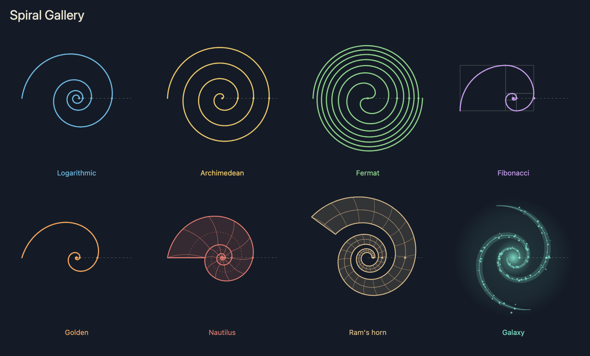

# Spiral-Gallery

The logarithmic, Archimedean, Fermat and Fibonacci spirals drawn side by side on the same scale, with the nautilus, the ram's horn and the galaxy. Every curve is scaled to end on the same circle, so the only thing left to compare is the way each one fills the space on the way out. No sign-up and no libraries.

- [Open the gallery](https://evoluteur.github.io/spiral-gallery/)

## What it does

- **Eight drawings**: the logarithmic spiral (with its growth per turn on a slider), the Archimedean, Fermat and Fibonacci spirals, the golden spiral, and the three that nature draws with the first one &mdash; a nautilus shell with its septa and siphuncle, a ram's horn with its growth ridges, and a two-armed galaxy.
- **Overlay**: all of them on one center, each still ending on the same circle, so the curves can be read against each other directly.
- **Mark each turn**: a dot wherever a curve comes back round to the ray it started on, and a ruler of those crossings under each drawing. Even ticks, bunching ticks or ticks that spread apart is the whole difference between these curves, in one line each.
- **The angle to the radius**: the radius, the tangent and the angle between them, at three radii. Only the logarithmic family reads the same number three times &mdash; that is what equiangular means.
- **The Fibonacci squares**: the scaffolding of squares of side 1, 1, 2, 3, 5, 8, &hellip; that the quarter arcs are fitted into.
- **A table** of every curve's polar equation, how its turns are spaced, its growth per turn, its angle to the radius and its pitch.
- **Four palettes**, three page themes, and **Download PNG** or **SVG** of the gallery as one sheet.

The address of the page keeps the settings, to share a particular comparison.

## How it works

Each spiral is a polar curve r(&theta;), sampled from the middle out and then scaled so that its outer end lands on the same radius as everyone else's. Two numbers do all the work of telling them apart:

- **&psi;**, the angle between the curve and the radius line drawn out to it.
- **G**, how much the radius grows over one whole turn.

For a logarithmic spiral, r = a&middot;eb&theta;, both are constant: &psi; = arctan(2&pi;/ln G) everywhere along the curve. That is the property, and it is the reason living things keep arriving at this curve. A nautilus cannot rebuild its shell as it grows, so it adds to the open end instead; if each new piece is a scaled copy of the last, the result has no choice but to follow a logarithmic spiral. Horns, tusks and claws do the same. A galaxy gets there from the other side: its arms are a density wave in a disc whose rotation is nearly flat, which winds a pattern up at a constant pitch.

Archimedes' spiral, r = a&theta;, adds the same *length* each turn instead, and Fermat's, r = a&radic;&theta;, adds the same *area* &mdash; so one has turns evenly spaced and the other has turns that crowd together, and both have a &psi; that creeps toward 90&deg; until the outer turns are indistinguishable from circles.

The Fibonacci spiral is not a spiral at all. It is a chain of quarter circles, one fitted into each square of a Fibonacci winding: squares of side 1, 1, 2, 3, 5, 8, &hellip; attached to the left, below, to the right and above a growing rectangle, over and over. The center of each arc turns out to always be a corner of the rectangle the square was attached to, so the chain joins up without any fitting. It converges on the golden spiral, since consecutive Fibonacci numbers run to &phi;, but the curvature jumps at every square and &psi; swings a few degrees either side of 72.97&deg; instead of holding still.

And the nautilus is not the golden spiral. Both are logarithmic, and there the resemblance stops: the golden spiral multiplies its radius by &phi;&#8308; = 6.854 every turn, while measured nautilus shells come in near 3.2 &mdash; roughly the value that makes each whorl sit against the one before it. Put the two side by side and the claim does not survive the picture.

## How it is built

Plain HTML, CSS and JavaScript, with no dependencies and no build step. Just open `index.html`. It is also a small installable web app that works offline.

- Every drawing is one SVG built from the sampled points, including the shell, the horn and the galaxy: the shell is the band between the curve and the same curve one turn back, the horn is that band with the width kept proportional to the radius, and the galaxy's arms are the same band tapered to nothing at the tip. All the code is in [js/spirals.js](https://github.com/evoluteur/spiral-gallery/blob/main/js/spirals.js).
- The three page themes (dark, light and blue) are shared with my other projects, copied from [omg-themes](https://github.com/evoluteur/omg-themes) (`npm run sync:themes` refreshes them).

Spiral-Gallery is open source at [GitHub](https://github.com/evoluteur/spiral-gallery) with MIT license.

Had fun browsing the app? [Buy me a coffee by becoming a sponsor](https://github.com/sponsors/evoluteur).

You may also be interested in [Archimedean-Solids](https://github.com/evoluteur/archimedean-solids) ([demo](https://evoluteur.github.io/archimedean-solids/)), [Sacred-Geometry](https://github.com/evoluteur/sacred-geometry) ([demo](https://evoluteur.github.io/sacred-geometry/)), [Cymatics](https://github.com/evoluteur/cymatics) ([demo](https://evoluteur.github.io/cymatics/)) and [Celtic-Knot-Maker](https://github.com/evoluteur/celtic-knot-maker) ([demo](https://evoluteur.github.io/celtic-knot-maker/)). For more mystic arts as small web apps, see [Esoterica](https://evoluteur.github.io/esoterica.html).

Copyright (c) 2026 [Olivier Giulieri](https://evoluteur.github.io/).
